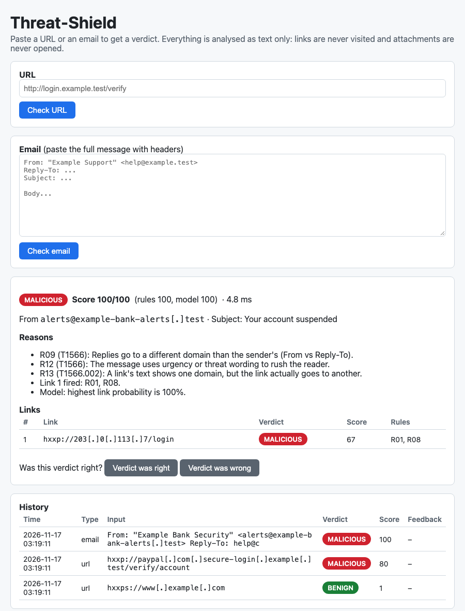

# Threat-Shield

A small local web app that checks a **URL** or a pasted **email** and returns a
verdict (benign / suspicious / malicious), a score from 0 to 100, and the reasons.
It combines 14 hand-written rules, each mapped to a MITRE ATT&CK technique, with a
logistic-regression model, logs every check, and uses right/wrong feedback to tune
the rules.

It is a one-day learning project, not production software.

**Safety design:** the app never fetches, opens or resolves a submitted URL, and
never opens attachments. It analyses text only. URLs are shown defanged
(`hxxp://example[.]com`) and all input is HTML-escaped.



## How it works

```
 input (URL or email)
        │
        ▼
 features.py / email_parser.py      text only: no network
        │
   ┌────┴─────────────┐
   ▼                  ▼
 rules.py           model.py
 14 rules           logistic regression
 (rules.yaml)       on 11 URL features
   │                  │
   └────┬─────────────┘
        ▼
 scorer.py   score = 0.5 × rule_score + 0.5 × model_probability × 100
        │
        ▼
 app.py + db.py   verdict, reasons, history, repeat-domain alert
        │
        ▼
 feedback buttons ──► tune.py halves the points of noisy rules ──► rule_weights.json
```

- **Rules** catch known tricks and give a readable reason, e.g. a Reply-To on a
  different domain from the sender (R09) or a brand name in a subdomain (R04).
- **The model** scores how much a URL looks like past phishing. For an email,
  it uses the highest probability among the email's links.
- **Verdict cut-offs** are chosen on validation data by `evaluate.py` and saved in
  `thresholds.json` (currently suspicious ≥ 20, malicious ≥ 25).

| Rule | Fires when | ATT&CK |
|---|---|---|
| R01 | Host is a raw IP address | T1566.002 |
| R02 | `@` in the host part of the URL | T1566.002 |
| R03 | Punycode host (`xn--`) | T1036 |
| R04 | Brand in subdomain or path, not the registered domain | T1036 |
| R05 | Four or more subdomain levels | T1566.002 |
| R06 | Login/verify wording plus hyphens in the host | T1566.002 |
| R07 | Known URL shortener | T1566.002 |
| R08 | No HTTPS | T1566.002 |
| R09 | From domain differs from Reply-To domain | T1566 |
| R10 | Display name names a brand, sender domain is not that brand | T1036 |
| R11 | SPF, DKIM or DMARC `fail` in Authentication-Results | T1566 |
| R12 | Urgency or threat wording | T1566 |
| R13 | Link text shows one domain, link goes to another | T1566.002 |
| R14 | Risky attachment name (.html, .js, .exe, .iso, double extension) | T1566.001 |

T1566 is Phishing (.001 attachment, .002 link); T1036 is Masquerading.

## How to run

You need Python 3.9 or newer. It was developed and tested on 3.9.6; the project
spec targets 3.11+.

```bash
# 1. Install
python3 -m venv .venv
source .venv/bin/activate
pip install -r requirements.txt

# 2. Get the dataset (not committed): the PhiUSIIL Phishing URL Dataset
#    https://archive.ics.uci.edu/dataset/967/phiusiil+phishing+url+dataset
#    Download, unzip, and save the CSV as data/phishing_urls.csv
#    Note: in this file label 1 = legitimate, 0 = phishing (the code flips it).

# 3. Train the model and print the metrics (creates model.joblib and thresholds.json)
python evaluate.py

# 4. Start the web app, then open http://127.0.0.1:8000
uvicorn app:app --reload

# 5. Tests
pytest

# 6. After collecting feedback in the app: tune the rule weights
python tune.py
```

## Results

From `python evaluate.py`. The data is split 70 / 15 / 15 (train / validation /
test), stratified, with a fixed seed. The model is trained on train, every threshold
is chosen on validation, and every number below is on the **test split of 35,370
URLs** (15,142 phishing).

| Detector | Threshold | Precision | Recall | F1 | FP rate | False positives | Missed phishing |
|---|---|---|---|---|---|---|---|
| Rules only | 5 | 1.000 | 0.548 | 0.708 | 0.000 | 0 | 6,841 |
| Model only | 45 | 0.967 | 0.905 | 0.935 | 0.023 | 473 | 1,436 |
| **Hybrid** | 20 | **0.960** | **0.912** | **0.936** | 0.029 | 578 | 1,326 |

Accuracy is deliberately not reported: real traffic is mostly benign, so a
detector that always says "benign" would have high accuracy and catch nothing.

**Rule tuning.** `evaluate.py` replays the validation set as if it were analyst
feedback and runs the tuning (a rule with at least 5 hits and precision under 50%
has its points halved). On this dataset **every rule had precision 1.00 on
validation, so no rule was changed** and false positives stayed the same (rules
only: 0 → 0; hybrid: 578 → 578). The tuning logic is covered by unit tests;
the dataset simply never triggered it (see the dataset bias under Limitations).

**Model weights** (scaled features; positive = more phishing-like): digit count
+16.1, length +8.5, HTTPS −6.8, hyphens +1.3, brand outside registered domain +0.9.

## Limitations

- **Dataset bias.** Every legitimate URL in PhiUSIIL is an `https://www.` homepage
  with no path, while many phishing URLs use `http` and long paths. The model
  partly learns that shortcut (see the HTTPS and length weights). This is why
  rules alone show zero false positives and why tuning found nothing to fix.
  Real-world performance would be lower.
- **Random split.** Train and test come from the same period. A time-based split
  (train on old, test on new) would be more realistic.
- **Simulated feedback.** The tuning experiment uses labelled data, not real analysts.
- **Low verdict cut-offs.** Because most phishing URLs fire no rule, the 50/50
  average pulls hybrid scores down, so the best cut-offs came out at 20 / 25
  rather than 40 / 70. Many URLs the model is unsure about are labelled malicious.
- **Text only.** It cannot see the page itself, so it misses compromised legitimate
  sites, clean-looking new domains, text inside images and QR codes. The email
  model score comes from links only; the email body is scored by rules alone.
- **Email domain in history.** The repeat-domain alert uses the sender's domain for
  emails, not the link domains.

## What I would add next

Visiting the page in an isolated sandbox, threat-intelligence lookups, domain-age
checks, a dataset whose legitimate URLs include deep links, a time-based split and
evasion testing, and a text model for email bodies.

## Files

| File | What it does |
|---|---|
| `features.py` | Turns a URL string into a dictionary of numeric features |
| `email_parser.py` | Reads pasted email: From, Reply-To, Authentication-Results, body, links, attachment names |
| `rules.yaml` | The 14 rules as data (id, points, reason, ATT&CK id) |
| `rules.py` | Loads the rules (and tuned weights) and returns which ones fired |
| `model.py` | `train()` fits and saves the model; `predict(url)` returns a probability |
| `scorer.py` | Combines rule points and model probability into score, verdict and reasons |
| `db.py` | SQLite tables: `analyses` (every check) and `feedback` |
| `app.py` | Web routes: home, analyse URL, analyse email, feedback |
| `templates/index.html` | The one page: input boxes, result card, alerts, history |
| `tune.py` | Reads feedback, halves the points of noisy rules, writes `rule_weights.json` |
| `evaluate.py` | Splits data, trains, prints metrics and the before/after tuning count |
| `tests/` | 38 tests using made-up URLs and emails on reserved domains |
